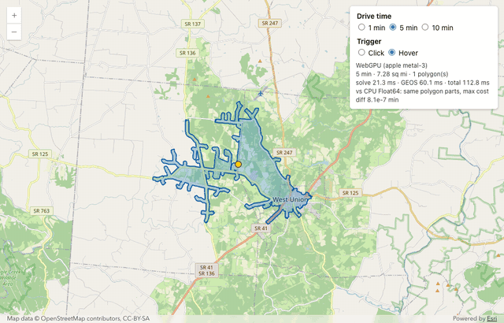
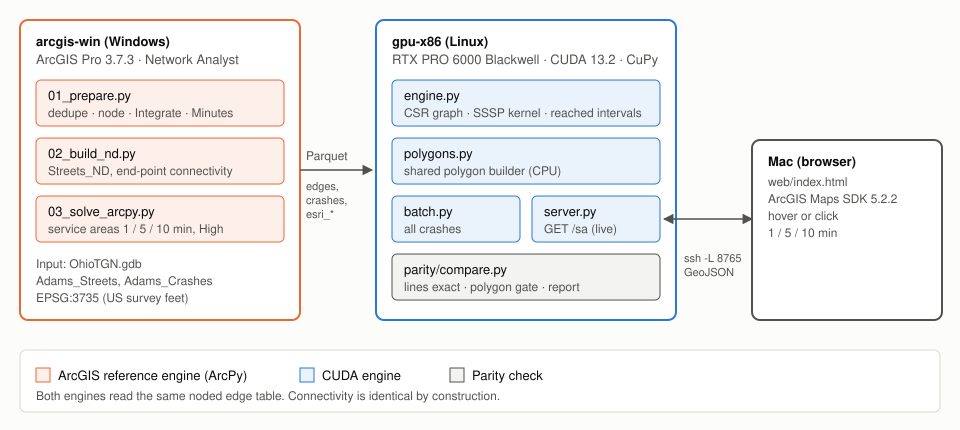
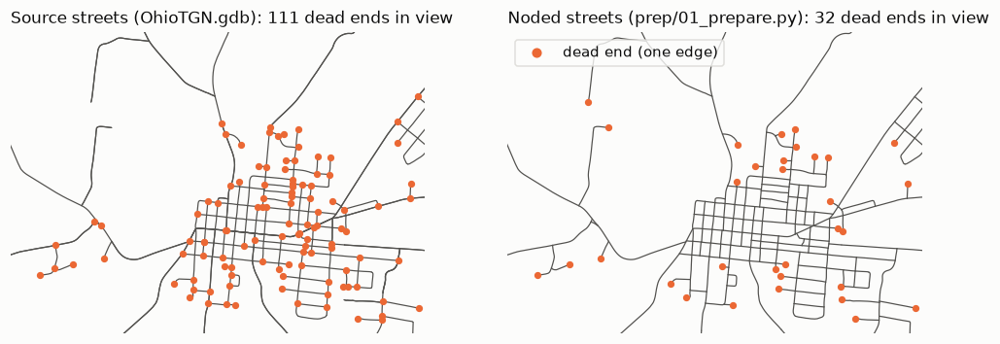
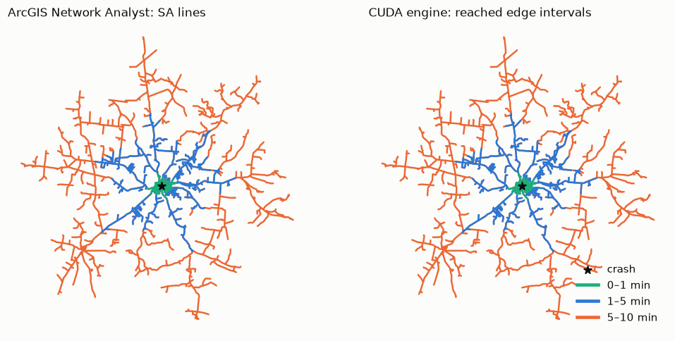
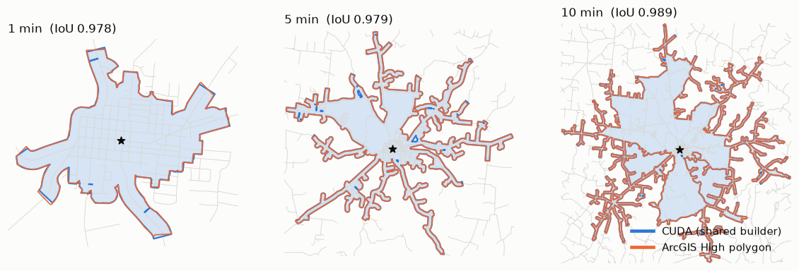
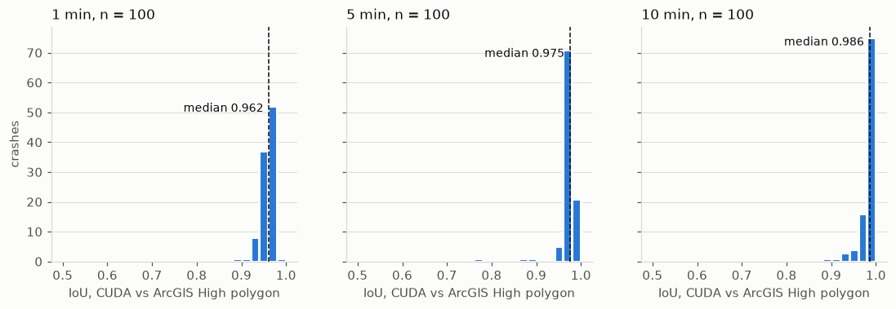
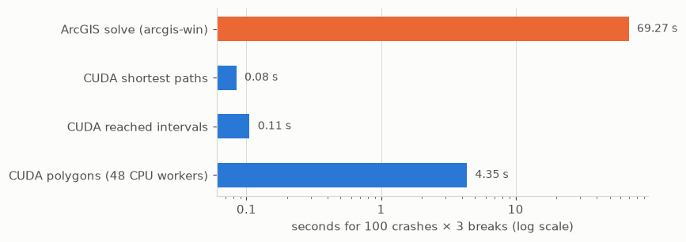
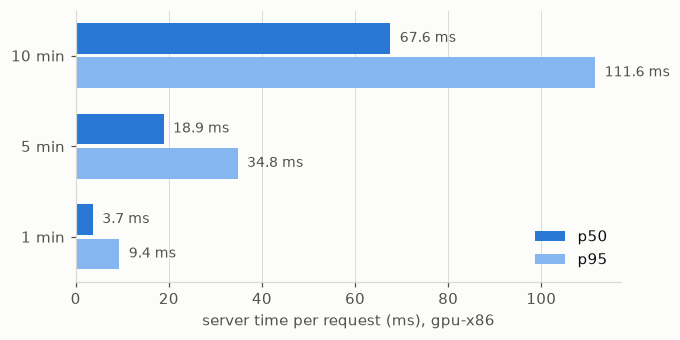
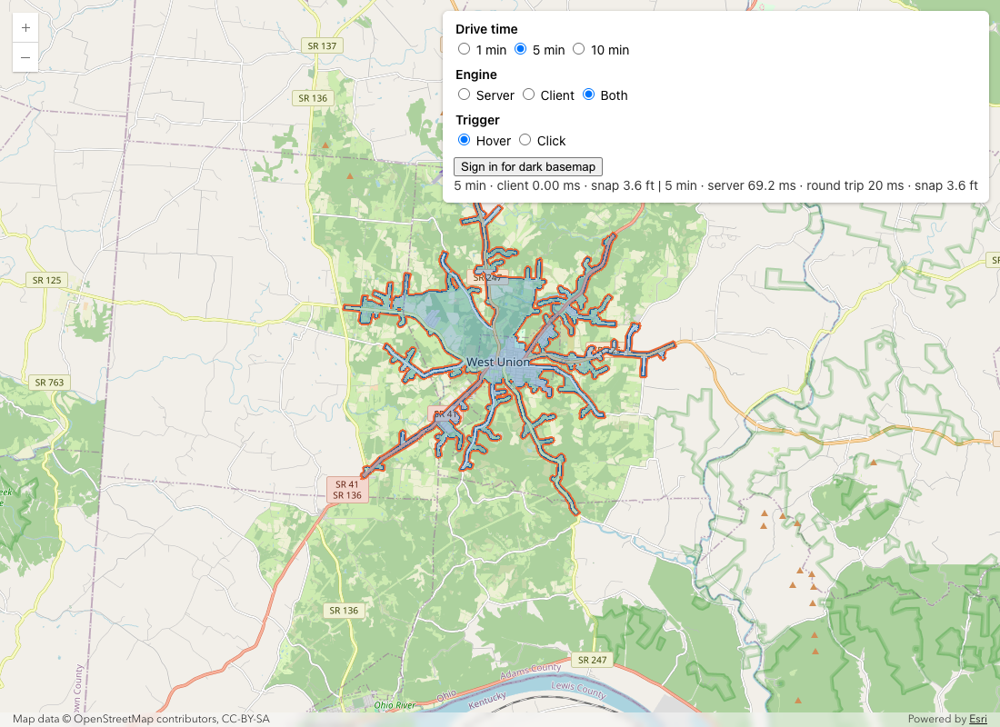
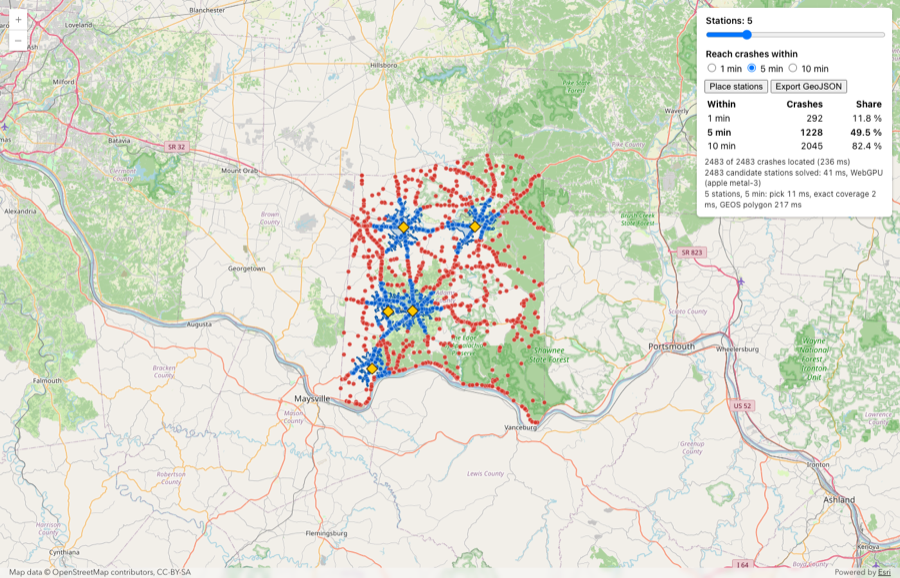

<h1>CUDA Service Areas with ArcGIS Parity</h1>

This repository calculates drive-time service areas on a street network.
The <b>ArcGIS engine</b> uses ArcGIS Network Analyst through ArcPy.
The <b>CUDA engine</b> uses a GPU shortest-path kernel.
A parity check compares the two engines.
A live server and a web map show one service area at the mouse position.
The <b>browser engines</b> calculate the service area in the browser: JavaScript and WebGL (section 14),
and WebGPU with GEOS in WebAssembly (sections 15 to 17).

  
   <em>The live page (section 17): the mouse moves along one street near West Union. WebGPU and GEOS update the 5-minute service area at each position.</em>

The study area is Adams County, Ohio.
The start points are the crash points in <code>Adams_Crashes</code>.
The breaks are 1, 5, and 10 minutes.

  
   <em>Figure 1. Three machines. Both engines read the same noded edge table.</em>

<h2>Contents</h2>
<ol>
  <li><a href="#terms">Terms</a></li>
  <li><a href="#results">Results</a></li>
  <li><a href="#data">Data</a></li>
  <li><a href="#travel-time">Travel time</a></li>
  <li><a href="#arcgis-engine">ArcGIS engine</a></li>
  <li><a href="#cuda-engine">CUDA engine</a></li>
  <li><a href="#polygon-builder">Polygon builder</a></li>
  <li><a href="#parity">Parity</a></li>
  <li><a href="#performance">Performance</a></li>
  <li><a href="#live-server-and-web-map">Live server and web map</a></li>
  <li><a href="#procedures">Procedures</a></li>
  <li><a href="#repository-layout">Repository layout</a></li>
  <li><a href="#known-limits">Known limits</a></li>
  <li><a href="#client-engine">Client engine (WebGL)</a></li>
  <li><a href="#browser-compute">Browser compute: WASM and WebGPU</a></li>
  <li><a href="#station-planner">Station planner (WebGPU and WebAssembly)</a></li>
  <li><a href="#live-page">Live service area (WebGPU and WebAssembly)</a></li>
  <li><a href="#gpu-arm">Alternative host: gpu-arm</a></li>
</ol>

<h2 id="terms">1. Terms</h2>

This document uses each term with one meaning only.

<table>
  <tr><th>Term</th><th>Meaning</th></tr>
  <tr><td>crash</td><td>One point in <code>Adams_Crashes</code>. Each crash is one start point (facility).</td></tr>
  <tr><td>break</td><td>A travel-time limit: 1, 5, or 10 minutes.</td></tr>
  <tr><td>edge</td><td>One street line between two nodes, after noding.</td></tr>
  <tr><td>node</td><td>An edge end. Edges connect only at nodes.</td></tr>
  <tr><td>position</td><td>A location along an edge, from 0 (start of the line) to 1 (end of the line).</td></tr>
  <tr><td>reached interval</td><td>The part of an edge, from position <i>lo</i> to position <i>hi</i>, that a crash reaches within a break.</td></tr>
  <tr><td>line</td><td>One reached interval as a line geometry. ArcGIS calls this output "SA Lines".</td></tr>
  <tr><td>polygon</td><td>The service-area area for one crash and one break.</td></tr>
  <tr><td>trim</td><td>The polygon buffer distance: 100 m (328.083 US survey feet).</td></tr>
  <tr><td>gpu-x86</td><td>The Linux GPU machine. It runs the CUDA engine and the live server.</td></tr>
  <tr><td>gpu-arm</td><td>An alternative Linux GPU machine (NVIDIA GB10, aarch64). It runs the same CUDA engine and live server as gpu-x86 (section 18).</td></tr>
  <tr><td>arcgis-win</td><td>The Windows machine. It runs ArcGIS Pro 3.7.3 with Network Analyst.</td></tr>
</table>

<h2 id="results">2. Results</h2>

The parity sample is 100 crashes (random seed 7).
The full ArcGIS run uses all 2,483 crashes.

<table>
  <tr><th>Check</th><th>Result</th></tr>
  <tr><td>Cumulative minutes, CUDA vs ArcGIS lines</td><td>0 mismatches in 84,676 lines. Maximum difference: 1.8e-15 min.</td></tr>
  <tr><td>Reached intervals, CUDA vs ArcGIS lines</td><td>1 mismatch in 97,362 interval sets. ArcGIS did not split that line at the break (see <a href="#esri-unsplit">8.4</a>).</td></tr>
  <tr><td>Own snapping vs ArcGIS locations</td><td>Same result as above. Maximum cost difference: 5.2e-11 min.</td></tr>
  <tr><td>Polygon gate (shared builder)</td><td>299 of 300 pass. The one failure is the same crash as the interval mismatch.</td></tr>
  <tr><td>Native ArcGIS polygons (reference only)</td><td>Median IoU 0.962 (1 min), 0.975 (5 min), 0.986 (10 min).</td></tr>
  <tr><td>Batch time, 100 crashes</td><td>ArcGIS solve 69.3 s. CUDA shortest paths 0.08 s, reached intervals 0.11 s, polygons 4.35 s.</td></tr>
  <tr><td>Live server, p50</td><td>3.7 ms (1 min), 18.9 ms (5 min), 67.6 ms (10 min).</td></tr>
</table>

<h2 id="data">3. Data</h2>

<h3>3.1 Source</h3>
<ul>
  <li>File geodatabase: <code>OhioTGN.gdb</code>. It is not in this repository.</li>
  <li>Test data in this repository, Adams County only: <code>work/Adams</code> (prepared streets and crashes) and <code>work/Adams_s100</code> (the same streets, the 100-crash sample and the ArcGIS results: lines, polygons, facility locations, timing). With these files the CUDA batch and the parity gate run with no ArcGIS licence (section 11).</li>
  <li>Streets: <code>Adams_Streets</code>, 3,063 lines. Fields: <code>NAME</code>, <code>MTFCC</code>, <code>TGN_SID</code>, and crash statistics.</li>
  <li>Crashes: <code>Adams_Crashes</code>, 2,483 points.</li>
  <li>Spatial reference: NAD83 / Ohio South, US survey feet (EPSG:3735). XY tolerance: 0.00328083 ft.</li>
  <li>The data has no speed field and no one-way field. All Z values are 0.</li>
</ul>

<h3>3.2 Defects in the source streets</h3>

The source streets are not ready for a network. The prepare step corrects three defects.

<ol>
  <li><b>Streets are not noded.</b> 1,453 street ends touch the inside of another street (T-junctions). 453 street pairs cross with no shared node. The raw network has 1,673 separate components.</li>
  <li><b>Streets are duplicated.</b> 467 groups of lines have the same geometry. They have the same <code>MTFCC</code> and different names (for example "Co Rd 27" and "Steam Furnace Rd").</li>
  <li><b>Connected ends are not always bit-identical.</b> ArcGIS connects ends within the XY tolerance. The CUDA engine connects only equal coordinates.</li>
</ol>

<h3>3.3 Prepare step (<code>prep/01_prepare.py</code>)</h3>
<ol>
  <li>Remove walkways and bike paths (<code>MTFCC</code> S1710 and S1820).</li>
  <li>Split local streets at all crossings and T-junctions (<code>FeatureToLine</code>).</li>
  <li>Split freeways and ramps (S1100, S1630) only where a street ends on them (<code>SplitLineAtPoint</code>). This keeps overpasses unconnected.</li>
  <li>Merge the two sets into <code>Net/Streets</code>.</li>
  <li>Snap ends within the XY tolerance to one coordinate (<code>Integrate</code>).</li>
  <li>Delete duplicate lines (same coordinates in either direction).</li>
  <li>Calculate <code>EID</code>, <code>MPH</code>, and <code>Minutes</code> for each edge.</li>
</ol>

The result has 5,035 edges, 4,357 nodes, and 22 components.
The largest component holds 98.7% of the nodes.

  
   <em>Figure 2. West Union. Orange points are dead ends. Noding removes the false dead ends at T-junctions.</em>

<h2 id="travel-time">4. Travel time</h2>

<code>speeds.py</code> holds the speed table.
Both engines use the same <code>Minutes</code> field.
All streets are two-way.

<code>Minutes = length_ft / 5280 / MPH × 60</code>

<table>
  <tr><th>MTFCC</th><th>Street class</th><th>MPH</th></tr>
  <tr><td>S1100</td><td>Primary road (interstate)</td><td>65</td></tr>
  <tr><td>S1200</td><td>Secondary road</td><td>45</td></tr>
  <tr><td>S1400</td><td>Local street</td><td>30</td></tr>
  <tr><td>S1500</td><td>4WD trail</td><td>10</td></tr>
  <tr><td>S1630</td><td>Ramp</td><td>35</td></tr>
  <tr><td>S1640</td><td>Service drive</td><td>25</td></tr>
  <tr><td>S1730</td><td>Alley</td><td>10</td></tr>
  <tr><td>S1740</td><td>Private road</td><td>10</td></tr>
  <tr><td>S1750</td><td>Internal census road</td><td>15</td></tr>
  <tr><td>S1780</td><td>Parking lot road</td><td>5</td></tr>
  <tr><td>other</td><td>Unknown class</td><td>25</td></tr>
</table>

<h2 id="arcgis-engine">5. ArcGIS engine</h2>

<h3>5.1 Network dataset (<code>prep/02_build_nd.py</code>)</h3>
<ul>
  <li>The script builds <code>Net/Streets_ND</code> from <code>prep/streets_nd_template.xml</code>.</li>
  <li>Connectivity is end-point. Edges connect only at their ends.</li>
  <li>The cost attribute <code>Minutes</code> reads the field <code>!Minutes!</code> in both directions.</li>
  <li>The template has no travel modes. <code>arcpy.nax</code> does not accept a network without travel modes. The solve script uses the layer API with a JSON travel mode.</li>
</ul>

<h3>5.2 Solve (<code>prep/03_solve_arcpy.py</code>)</h3>
<table>
  <tr><th>Setting</th><th>Value</th></tr>
  <tr><td>Tool</td><td><code>MakeServiceAreaAnalysisLayer</code>, <code>AddLocations</code>, <code>Solve</code></td></tr>
  <tr><td>Impedance</td><td><code>Minutes</code></td></tr>
  <tr><td>Breaks</td><td>1, 5, 10</td></tr>
  <tr><td>Direction</td><td>From facilities</td></tr>
  <tr><td>Output</td><td>Polygons and lines</td></tr>
  <tr><td>Polygon detail</td><td>High</td></tr>
  <tr><td>Geometry at overlap / cutoff</td><td>Overlap / Disks</td></tr>
  <tr><td>Polygon trim</td><td>100 m</td></tr>
  <tr><td>Search tolerance</td><td>5,000 m</td></tr>
  <tr><td>U-turns</td><td>Allowed</td></tr>
</table>

The script writes Parquet files to <code>work/&lt;County&gt;</code>, or to <code>work/&lt;County&gt;_s&lt;N&gt;</code> for a sample.
It writes <code>edges</code>, <code>crashes</code>, <code>esri_facilities</code>, <code>esri_lines</code>, <code>esri_polygons</code>, and <code>esri_timing.json</code>.
It also prints the number of crashes that ArcGIS did not locate (<code>Status</code> not 0).

<h2 id="cuda-engine">6. CUDA engine</h2>

<h3>6.1 Graph (<code>cuda/engine.py</code>, <code>Graph</code>)</h3>
<ul>
  <li>The graph reads <code>edges.parquet</code>.</li>
  <li>Edge ends with equal coordinates become one node.</li>
  <li>The graph stores the edges in CSR format (compressed sparse rows), with both directions of each edge.</li>
  <li>Costs are 64-bit floats. This keeps cumulative minutes equal to ArcGIS within 1e-12.</li>
  <li>The graph copies its arrays to the GPU at the first GPU call. CPU-only processes can load the graph without CUDA.</li>
</ul>

<h3>6.2 Location</h3>
<ul>
  <li>Esri mode: the engine uses the ArcGIS location of each crash (<code>SourceOID</code>, <code>PosAlong</code>).</li>
  <li>Own mode: the engine finds the nearest edge with an STRtree. The position is the normalized distance along that edge.</li>
  <li>A crash farther than 5,000 m from all edges is not located. This is the same rule as ArcGIS.</li>
</ul>

<h3>6.3 Shortest-path kernel</h3>
<ul>
  <li>One CUDA thread block calculates the costs for one crash.</li>
  <li>The kernel starts at the two ends of the crash edge. The start costs are <code>position × w</code> and <code>(1 − position) × w</code>. <i>w</i> is the edge cost in minutes.</li>
  <li>The kernel uses worklist Bellman-Ford. Each round relaxes the edges of the nodes that changed in the last round.</li>
  <li>An atomic minimum on the 64-bit pattern of the cost updates a node. Non-negative doubles sort in the same order as their bit patterns.</li>
  <li>The kernel stops a path when its cost is more than the largest break (10 min). One solve gives the costs for all three breaks.</li>
  <li>The batch tool sends crashes in chunks of 2,048.</li>
</ul>

<h3>6.4 Reached intervals (<code>Graph.reached</code>)</h3>

For each edge (<i>u</i>, <i>v</i>) with cost <i>w</i>, node costs <i>cu</i> and <i>cv</i>, and break <i>B</i>:

<ul>
  <li>From the start node: <code>[0, a1]</code> with <code>a1 = clip((B − c_u) / w, 0, 1)</code>.</li>
  <li>From the end node: <code>[b0, 1]</code> with <code>b0 = clip(1 − (B − c_v) / w, 0, 1)</code>.</li>
  <li>On the crash edge only: <code>[s0, s1]</code> with <code>s0 = clip(p − B / w)</code> and <code>s1 = clip(p + B / w)</code>. <i>p</i> is the crash position.</li>
  <li>The union of these parts is the reached interval for that edge and break.</li>
</ul>

  
   <em>Figure 3. One crash. Left: ArcGIS lines. Right: CUDA reached intervals. The colors show the break bands.</em>

<h2 id="polygon-builder">7. Polygon builder</h2>

<code>cuda/polygons.py</code> (<code>Builder</code>) makes one polygon from the reached intervals of one crash and one break.
The parity check applies the same builder to the ArcGIS lines.
The rules come from a comparison with ArcGIS High polygons.

<ol>
  <li>Buffer each reached interval by the trim distance. Use flat caps. ArcGIS cuts flat at the cutoff point.</li>
  <li>Add a round disk (trim radius) at each reached node where all edges are fully reached.</li>
  <li>Add a round disk at each reached dead end.</li>
  <li>Fill each network face (block) when all edges on its boundary and inside it are fully reached.</li>
  <li>Join all parts into one polygon.</li>
  <li>Keep only the ground whose nearest street is reached there. The builder cuts each street into pieces of at most 50 ft. Each piece owns the ground that is nearer to it than to any other piece (a Voronoi cell). The polygon keeps only the cells of reached pieces. Without this step, a buffer along a freeway also covers the unreached streets beside it. ArcGIS does not include that ground.</li>
  <li>Remove holes smaller than 1e-6 ft². The join makes these holes where two flat caps almost touch.</li>
</ol>

The builder treats two positions closer than 1e-9 as equal.
Floating-point noise does not create sliver lines or change the "fully reached" test.

  
   <em>Figure 4. One crash. Blue: CUDA polygon (shared builder). Orange: native ArcGIS High polygon.</em>

<h2 id="parity">8. Parity</h2>

<h3>8.1 Gates (<code>parity/compare.py</code>)</h3>
<table>
  <tr><th>Gate</th><th>Rule</th></tr>
  <tr><td>Lines: cost</td><td>For each ArcGIS line, the CUDA cost at <code>FromPosition</code> and <code>ToPosition</code> equals <code>FromCumul_Minutes</code> and <code>ToCumul_Minutes</code> within 1e-6 min.</td></tr>
  <tr><td>Lines: intervals</td><td>For each crash, edge, and break, the reached intervals are equal within 1e-6.</td></tr>
  <tr><td>Polygons</td><td>The shared builder on the ArcGIS intervals and the CUDA polygon have IoU ≥ 0.99 and Hausdorff distance ≤ 50 ft.</td></tr>
  <tr><td>Reference (no gate)</td><td>Native ArcGIS High polygons vs CUDA polygons. The report gives the IoU and Hausdorff distribution.</td></tr>
</table>

<h3>8.2 Why polygons use a shared builder</h3>

The nearest-street step came from a test of 10 candidate rules against native ArcGIS polygons. It raised the median IoU in Franklin (20 crashes) from 0.86 / 0.93 / 0.95 to 0.97 / 0.97 / 0.97 for 1 / 5 / 10 minutes, and in Adams (100 crashes) from 0.94 / 0.97 / 0.98 to 0.96 / 0.98 / 0.99.
The browser engines use the same step. The WebGL layer finds the nearest street of each pixel with the depth buffer. The GEOS polygon (<code>geom.js</code>) makes the same cells in the browser from the piece points in <code>web/data/adams.bin</code>; this takes approximately 2.5 s one time, when the page loads.
A piece that is reached in part counts as reached. Thus the polygon can keep up to 50 ft of ground after a break position, where another reached street covers that ground.

The ArcGIS polygon algorithm is not published.
ArcGIS High polygons are smoothed buffers.
Their boundary points are 300 to 345 ft from the reached lines, not exactly 328 ft.
Exact geometric parity with native polygons is not possible.
The lines are exact. A shared builder makes the polygon parity exact for the same lines.

  
   <em>Figure 5. IoU of CUDA polygons against native ArcGIS High polygons, 100 crashes per break.</em>

<h3>8.3 Report</h3>

The comparison exits with status 1 when either gate fails, or required artifacts are missing or their SHA-256 hashes differ from the completed CUDA run. Re-run the batch after changing reference inputs. Use <code>--lines-only</code> explicitly for a partial check; this is not a full parity pass. Batch runs invalidate old polygon output and archive previous timing JSON files with a timestamp suffix.

Reports include Windows ArcPy and CUDA stage timings. <code>python parity/benchmark.py Adams_s100</code> on gpu-x86 records one warm-up and seven measured runs on the same facilities, with serial polygon timings labelled separately from batch pool timings. Results retain the Windows timing record and network hash in timestamped JSON files. These measurements alone do not establish an optimization speedup.

The report is <code>results/parity_&lt;county&gt;_&lt;mode&gt;.md</code>.
It lists the mismatch counts, the IoU and Hausdorff table per break, and the 10 worst polygons.
The check runs in about 5 s for 100 crashes on gpu-x86.
Equal polygons skip the geometry work.
Other polygons go to a process pool.

<h3 id="esri-unsplit">8.4 ArcGIS unsplit lines</h3>

ArcGIS usually splits a line where it crosses a break.
Sometimes ArcGIS does not split the line.
It puts the full line into the next break band.
In the full Adams run, this occurs 17 times in 2,168,587 lines.
ArcGIS splits 244,266 lines at a break.

No tolerance explains this behavior.
The leftover lengths of split and unsplit lines overlap in feet, in minutes, and in edge fraction.
One edge is split for one crash and not split for another crash.
The CUDA engine always splits.
The report marks each such case as <code>[Esri unsplit crossing]</code>.
The gate counts these cases as failures.

<b>Note (12 November 2026): where the difference comes from.</b>

<ul>
  <li>The difference is in the ArcGIS line output. It is not in the CUDA shortest paths.</li>
  <li>For each of these lines, the ArcGIS travel times at the two ends are equal to the CUDA travel times within 1e-6 min. Thus the two engines agree on the position where the travel time is equal to the break. CUDA cuts the line at that position. ArcGIS does not cut it.</li>
  <li>The street geometry is not the cause. The OGC geometry check (<code>prep/00_repair_source.py</code>) found 0 problems in the Adams and Franklin source layers. One edge is split for one crash and not split for another crash.</li>
  <li>The Franklin pilot (20 crashes) shows the same behavior: 2 unsplit lines (crash 49470 at 5 min, crash 111391 at 1 min) and no other line difference.</li>
  <li>An unsplit line can change a polygon. For crash 1800 (Adams, 5 min), the edge is not fully reached on the ArcGIS side, and one block is then not filled. The polygon IoU is 0.94.</li>
  <li>The rule that ArcGIS uses is not published. It is not known if the behavior is intended or a defect. Esri was not asked, and the behavior was not tested in isolation.</li>
  <li>This note is about lines only. The CUDA polygons are an approximation of the ArcGIS polygons (section 7).</li>
</ul>

<h2 id="performance">9. Performance</h2>

  
   <em>Figure 6. Batch time for 100 crashes and 3 breaks. The scale is logarithmic.</em>

<ul>
  <li>ArcGIS: 69.3 s for 100 crashes. 1,873 s for all 2,483 crashes.</li>
  <li>CUDA shortest paths: 0.08 s for 100 crashes on one RTX PRO 6000 Blackwell.</li>
  <li>CUDA polygons: 4.35 s on 48 CPU processes. Polygon construction is the largest CUDA-side cost. Before the nearest-street step (section 8.2) this was 2.41 s: the step adds the union of the Voronoi cells and one intersection for each polygon.</li>
  <li>Buffers of whole edges and node disks are made once per <code>Builder</code>. Serial polygon time for 100 crashes is 14.69 s on gpu-x86 and 8.26 s on gpu-arm (before the nearest-street step: 10.65 s and 5.24 s).</li>
  <li>The live server runs the union on 8 threads (<code>Builder.polygon(pool=)</code>). Server p50 at 10 minutes went from 97.8 ms to 34.2 ms with the threads. The nearest-street step then raised it to 67.6 ms. All 7,449 Adams polygons agree with the serial union (Hausdorff below 0.0001 ft). The batch keeps the serial union, so its files stay identical.</li>
</ul>

  
   <em>Figure 7. Live server time per request on gpu-x86 (100 random points near crashes).</em>

<table>
  <tr><th>Break</th><th>Server p50</th><th>Server p95</th><th>Round trip p50 (on gpu-x86)</th><th>Round trip p95 (on gpu-x86)</th></tr>
  <tr><td>1 min</td><td>3.7 ms</td><td>9.4 ms</td><td>4.7 ms</td><td>10.8 ms</td></tr>
  <tr><td>5 min</td><td>18.9 ms</td><td>34.8 ms</td><td>30.9 ms</td><td>248.6 ms</td></tr>
  <tr><td>10 min</td><td>67.6 ms</td><td>111.6 ms</td><td>270.7 ms</td><td>328.2 ms</td></tr>
</table>

The round trip includes JSON encoding and transfer. Large 10-minute polygons make the response large.

<h2 id="live-server-and-web-map">10. Live server and web map</h2>

<h3>10.1 Server (<code>cuda/server.py</code>)</h3>
<table>
  <tr><th>Endpoint</th><th>Result</th></tr>
  <tr><td><code>GET /sa?lon=&amp;lat=&amp;minutes=</code></td><td>One polygon as a GeoJSON Feature in WGS84. <code>minutes</code> is more than 0 and not more than 10. The header <code>X-Solve-ms</code> gives the server time.</td></tr>
  <tr><td><code>GET /crashes</code></td><td>All crashes as GeoJSON points. <code>parity/latency.py</code> uses them as test points.</td></tr>
  <tr><td><code>GET /config</code></td><td>The portal URL and the OAuth client ID from the environment, and the SHA-256 of <code>edges.parquet</code>. The web map shows a warning when the client data is from a different file.</td></tr>
  <tr><td><code>GET /</code></td><td>The web map (<code>web/</code>).</td></tr>
</table>

The server listens on 127.0.0.1:8765 only.
The Mac connects through an SSH tunnel.
The server keeps the graph on the GPU.
Rings are oriented for the ArcGIS SDK (outer ring clockwise).

<h3>10.2 Web map (<code>web/</code>)</h3>
<ul>
  <li>The map uses ArcGIS Maps SDK for JavaScript 5.2.2 (pinned) and the <code>&lt;arcgis-map&gt;</code> component.</li>
  <li>The panel selects the break (1, 5, or 10 min) and the mode (Hover or Click).</li>
  <li>Hover mode sends one request at a time. When a response arrives, the map sends the newest mouse position. Old positions are not sent.</li>
  <li>A break change cancels the open request and solves the last point again.</li>
  <li>The status line shows the calculation time only: the server time and, for the browser engine, the client time.</li>
  <li>The default basemap is OpenStreetMap.</li>
  <li>After ArcGIS sign-in, the basemap changes to <code>dark-gray-vector</code>. The sign-in uses OAuth with a redirect to the page.</li>
</ul>

<h2 id="procedures">11. Procedures</h2>

Do the steps in the given order. Each step has one action.

<h3>11.1 Prepare gpu-x86 (one time)</h3>
<ol>
  <li>Connect to gpu-x86: <code>ssh gpu-x86</code>.</li>
  <li>Go to the project folder: <code>cd ~/service-area</code>.</li>
  <li>Make the environment: <code>uv venv -p 3.12 .venv</code>.</li>
  <li>Install the packages: <code>uv pip install -p .venv/bin/python cupy-cuda13x shapely pyproj pyarrow numpy fastapi uvicorn matplotlib scipy</code>.</li>
</ol>

<h3>11.2 Run the ArcGIS engine (arcgis-win)</h3>
<ol>
  <li>Copy <code>OhioTGN.gdb</code> to <code>%USERPROFILE%\service-area\data\</code>.</li>
  <li>Copy <code>speeds.py</code> and <code>prep\</code> to <code>%USERPROFILE%\service-area\</code>.</li>
  <li>Open a command prompt in <code>%USERPROFILE%\service-area</code>.</li>
  <li>Prepare the streets: <code>"C:\Program Files\ArcGIS\Pro\bin\Python\envs\arcgispro-py3\python.exe" prep\01_prepare.py Adams</code>.</li>
  <li>Build the network: <code>... prep\02_build_nd.py Adams</code>.</li>
  <li>Solve the 100-crash sample: <code>... prep\03_solve_arcpy.py Adams --sample 100 --seed 7</code>.</li>
  <li>Copy <code>work\Adams_s100\</code> to <code>~/service-area/work/</code> on gpu-x86.</li>
</ol>

Note: the full run (no <code>--sample</code>) takes about 31 minutes.

<h3>11.3 Run the CUDA engine and the parity check (gpu-x86)</h3>
<ol>
  <li>Run the tests: <code>.venv/bin/python -m unittest discover -s tests -v</code>.</li>
  <li>Run the CUDA engine with the ArcGIS locations: <code>.venv/bin/python cuda/batch.py Adams_s100 --locations esri</code>.</li>
  <li>Run the parity check: <code>.venv/bin/python parity/compare.py Adams_s100 --locations esri</code>.</li>
  <li>Read the report: <code>results/parity_adams_s100_esri.md</code>.</li>
  <li>Repeat steps 2 to 4 with <code>--locations own</code> to test the own snapping.</li>
</ol>

<h3>11.4 Start the live server and the web map</h3>
<ol>
  <li>Copy <code>work/Adams_s100/edges.parquet</code> and <code>crashes.parquet</code> to <code>work/Adams/</code> on gpu-x86.</li>
  <li>On the Mac, set <code>ARCGIS_PORTAL_URL</code> and <code>ARCGIS_CLIENT_ID</code>. This step is necessary only for the dark basemap.</li>
  <li>Start the server in tmux on gpu-x86:
<pre><code>ssh gpu-x86 "cd ~/service-area &amp;&amp; tmux new -d -s sa \"ARCGIS_PORTAL_URL=$ARCGIS_PORTAL_URL ARCGIS_CLIENT_ID=$ARCGIS_CLIENT_ID .venv/bin/python cuda/server.py Adams\""</code></pre></li>
  <li>Open the tunnel on the Mac: <code>ssh -N -L 8765:localhost:8765 gpu-x86</code>.</li>
  <li>Open <code>http://localhost:8765/</code> in a browser.</li>
  <li>Select the break.</li>
  <li>Move the mouse on the map.</li>
</ol>

Note: the OAuth app must list <code>http://localhost:8765/</code> as a redirect URI.
If it does not, the sign-in fails.

<h3>11.5 Stop the live server</h3>
<ol>
  <li>Stop the server: <code>ssh gpu-x86 'tmux kill-session -t sa'</code>.</li>
  <li>Stop the tunnel: press Ctrl+C in the tunnel terminal.</li>
</ol>

<h3>11.6 Measure the server time</h3>
<ol>
  <li>Start the server (11.4, steps 1 to 3).</li>
  <li>Run the benchmark on gpu-x86: <code>.venv/bin/python parity/latency.py --n 100 --out results/latency.md</code>.</li>
</ol>

<h3>11.7 Make the figures</h3>
<ol>
  <li>Export the raw streets on the Mac: <code>ogr2ogr -f GeoJSON -dim 2 adams_raw.geojson OhioTGN.gdb Adams_Streets -select MTFCC</code>.</li>
  <li>Copy <code>adams_raw.geojson</code> to <code>~/service-area/work/</code> on gpu-x86.</li>
  <li>Make the figures on gpu-x86: <code>.venv/bin/python docs/make_figures.py</code>.</li>
  <li>Copy <code>docs/images/</code> back to the repository.</li>
</ol>

<h3>11.8 Build and test the client engine</h3>
<ol>
  <li>Build the client data on gpu-x86: <code>.venv/bin/python client/build_client_data.py Adams</code>.</li>
  <li>Copy <code>web/data/</code> from gpu-x86 to the Mac repository.</li>
  <li>Run the engine test on the Mac: <code>node tests/test_client.mjs</code>.</li>
  <li>Start the server and the tunnel (11.4).</li>
  <li>Open <code>http://localhost:8765/client/check.html</code> to compare the client raster with the server polygon.</li>
  <li>Open <code>http://localhost:8765/</code>.</li>
  <li>Select the engine <b>Client</b> or <b>Both</b>.</li>
</ol>

<h2 id="repository-layout">12. Repository layout</h2>
<table>
  <tr><th>Path</th><th>Content</th></tr>
  <tr><td><code>speeds.py</code></td><td>MTFCC speed table. Both engines use it.</td></tr>
  <tr><td><code>prep/01_prepare.py</code></td><td>ArcPy: filter, node, snap, dedupe, calculate <code>Minutes</code>.</td></tr>
  <tr><td><code>prep/02_build_nd.py</code></td><td>ArcPy: build the network dataset from the template.</td></tr>
  <tr><td><code>prep/streets_nd_template.xml</code></td><td>Network dataset template with the <code>Minutes</code> cost.</td></tr>
  <tr><td><code>prep/03_solve_arcpy.py</code></td><td>ArcPy: service areas and Parquet export.</td></tr>
  <tr><td><code>cuda/engine.py</code></td><td>Graph, location, shortest-path kernel, reached intervals.</td></tr>
  <tr><td><code>cuda/polygons.py</code></td><td>Shared polygon builder.</td></tr>
  <tr><td><code>cuda/batch.py</code></td><td>Batch run for all crashes in a folder.</td></tr>
  <tr><td><code>cuda/server.py</code></td><td>Live FastAPI server.</td></tr>
  <tr><td><code>parity/compare.py</code></td><td>Parity gates and report.</td></tr>
  <tr><td><code>parity/latency.py</code></td><td>Server time benchmark.</td></tr>
  <tr><td><code>parity/benchmark.py</code></td><td>Warm repeated CUDA stage timings on the same facilities (8.3).</td></tr>
  <tr><td><code>tests/</code></td><td>GPU shortest path against Dijkstra, interval math, parity checker.</td></tr>
  <tr><td><code>web/</code></td><td>Web map (HTML and JavaScript).</td></tr>
  <tr><td><code>web/client/sa.js</code></td><td>Client engine: snap, shortest path, polygon-part flags. No SDK imports.</td></tr>
  <tr><td><code>web/client/layer.js</code></td><td>Client engine: WebGL2 layer (mask pass and composite pass).</td></tr>
  <tr><td><code>web/client/check.html</code></td><td>Pixel comparison of the client raster and the server polygon.</td></tr>
  <tr><td><code>client/build_client_data.py</code></td><td>Builds <code>web/data/</code> (graph, snap geometry, mesh, test fixture).</td></tr>
  <tr><td><code>tests/test_client.mjs</code></td><td>Node test: client engine against the CUDA engine.</td></tr>
  <tr><td><code>tests/test_client_arcpy.mjs</code></td><td>Node test: client lines against the ArcPy lines (14.4).</td></tr>
  <tr><td><code>tests/test_app.mjs</code></td><td>Node test: URL parameters of the web map (14.6), without the map SDK.</td></tr>
  <tr><td><code>web/client/gpu.js</code>, <code>web/client/geom.js</code></td><td>WebGPU shortest paths (fp32) and GEOS polygons (WebAssembly).</td></tr>
  <tr><td><code>web/client/planner.js</code>, <code>web/planner.html</code></td><td>Station planner (section 16).</td></tr>
  <tr><td><code>web/live.html</code></td><td>Live service area with WebGPU and GEOS (section 17).</td></tr>
  <tr><td><code>tests/test_client_geom.mjs</code>, <code>tests/test_planner.mjs</code>, <code>tests/bench_scale.mjs</code></td><td>Node tests: browser polygons, station planner, scale bench.</td></tr>
  <tr><td><code>docs/make_hover_gif.mjs</code></td><td>Records the hover animation.</td></tr>
  <tr><td><code>docs/</code></td><td>Figure script and figures.</td></tr>
  <tr><td><code>tasks/</code></td><td>Task list and lessons.</td></tr>
  <tr><td><code>work/</code>, <code>data/</code></td><td>Data and outputs. Git ignores these folders.</td></tr>
</table>

<h2 id="known-limits">13. Known limits</h2>
<ul>
  <li>The speeds come from the street class only. The data has no posted speeds and no one-way streets.</li>
  <li>Native ArcGIS polygons and CUDA polygons are not equal. Median IoU is 0.96 to 0.99 in Adams (100 crashes) and 0.97 in the Franklin pilot (20 crashes).</li>
  <li>17 ArcGIS lines in the full Adams run are not split at a break. The CUDA engine does not copy this behavior. The difference comes from the ArcGIS output, not from the CUDA paths; the ArcGIS rule is not known (8.4).</li>
  <li>Polygon construction runs on the CPU. It is the slowest CUDA-side step.</li>
  <li>The freeway and ramp split rule (3.3, step 3) ran for Franklin County (518 freeway and 1,010 ramp edges). The Franklin pilot of 20 crashes has exact lines. The run of 2,000 crashes is not compared yet.</li>
  <li>Adams County is tested in full. Franklin County has a pilot only.</li>
</ul>

<h2 id="client-engine">14. Client engine (WebGL)</h2>

The client engine is an alternative to the server engine.
It does not replace the server engine.
The browser does the calculation and the drawing.
The server only supplies static files.
The <b>Engine</b> control in the panel selects Server, Client, or Both.

  
   <em>Figure 8. Both mode at 5 minutes. Blue fill: client engine. Orange outline: server engine.</em>

<h3>14.1 Design</h3>
<ul>
  <li><b>Shortest path in JavaScript.</b> The graph is small (4,357 nodes). Dijkstra with a typed-array heap uses 64-bit floats. The costs are equal to the CUDA costs.</li>
  <li><b>No shortest path on the GPU.</b> WebGL has 32-bit floats only, and a texture readback is slower than the JavaScript solve.</li>
  <li><b>The rasterizer does the polygon union.</b> The layer draws all parts into an offscreen mask. Then it draws the mask one time with a fill and an outline. The client does not build polygon geometry.</li>
  <li><b>The cutoff is a per-pixel test.</b> Each street vertex holds its position <i>p</i> along the edge. The fragment shader calculates <code>cost = min(cu + p·w, cv + (1 − p)·w)</code> and discards the pixel when the cost is more than the break. The cut is perpendicular to the street. This gives the flat caps of the polygon builder.</li>
  <li><b>The mesh is static.</b> One solve changes three small textures only: the node costs per edge, the node disk flags, and the face flags.</li>
</ul>

<h3>14.2 Data (<code>client/build_client_data.py</code>)</h3>
<ul>
  <li>The script writes <code>web/data/adams.bin</code> (20.9 MB) and <code>web/data/adams.json</code>. Git ignores <code>web/data/</code>.</li>
  <li>Graph arrays: CSR, edge ends, edge minutes (Float64).</li>
  <li>Snap geometry: street vertices in Web Mercator, with the position along the edge from EPSG:3735 lengths.</li>
  <li>Mesh: street quads, round-join wedges, node disks, and face triangles. The script offsets all vertices by the trim distance in EPSG:3735. Then it projects them to Web Mercator.</li>
  <li>The mesh has 664,363 vertices and 277,153 triangles.</li>
</ul>

<h3>14.3 Snap</h3>
<ul>
  <li>The snap uses a 500 m grid of street segments in Web Mercator. It does not use a projection library.</li>
  <li>Web Mercator is not conformal on the ellipsoid. Its north-south scale is 0.4% different from its east-west scale. The snap corrects this difference. Without the correction, the snapped position is wrong by some millimetres.</li>
  <li>A point farther than 5,000 m from all streets is not located.</li>
</ul>

<h3>14.4 Results</h3>

Regenerate client fixtures for the default 100 crashes, then run <code>node tests/test_client.mjs</code> for CUDA agreement and seven warmed timing passes. Run <code>node tests/test_client_arcpy.mjs</code> for an independent ArcPy line gate. The known unsplit crossing remains a failure. The browser pixel check now reports PASS only at IoU ≥ 0.99; an empty selection or lower IoU reports ERROR.

<table>
  <tr><th>Check</th><th>Result</th></tr>
  <tr><td>Node costs, client vs CUDA (20 crashes)</td><td>Maximum difference: 0 min.</td></tr>
  <tr><td>Full edges, node disks, filled faces vs <code>Builder.classify</code> (20 crashes, 3 breaks)</td><td>Equal.</td></tr>
  <tr><td>Snapped position vs <code>Graph.locate</code></td><td>Same edge. Maximum position difference: 5.7e-7.</td></tr>
  <tr><td>Client raster vs server polygon (6 crashes, 3 breaks, 2048 px)</td><td>IoU 0.9955 to 0.9997.</td></tr>
  <tr><td>Time per mouse position (Node, mean)</td><td>Snap 0.003 ms, solve 0.031 ms (10 min), flags 0.040 ms.</td></tr>
</table>

The largest difference is 0.34% of one polygon area.
There, the GEOS flat-cap buffer on the server drops area at short end pieces after a bend.
The client draws the full union at these locations.

<h3>14.5 Limits of the client engine</h3>
<ul>
  <li>The client engine gives a picture, not polygon geometry. Use the server engine when geometry is necessary.</li>
  <li>The browser downloads 20.9 MB of data one time (it includes the EPSG:3735 geometry for browser polygons).</li>
  <li>The time values are from Node on the Mac. The frame rate in the browser is not measured.</li>
  <li>The layer does not draw world copies across the date line.</li>
</ul>

<h3>14.6 Deep link</h3>

The page accepts URL parameters.
Example: <code>http://localhost:8765/?engine=both&amp;minutes=5&amp;at=-83.5456,38.7948&amp;zoom=12</code>.
The page selects the options and solves at the given longitude and latitude.
The parameters <code>zoom</code> and <code>rotation</code> (degrees) are optional.

<h2 id="browser-compute">15. Browser compute: WASM and WebGPU</h2>

This section gives the results of an investigation. The full numbers are in <code>results/browser_compute.md</code>.

<ul>
  <li>The client engine does work only in the reached area. Each solve resets only the nodes that it reached. The layer uploads only the texture rows that changed.</li>
  <li>On 100 copies of Adams (503,500 edges), flags take 0.10 ms. Before the change, flags took 5.96 ms.</li>
  <li>A WebAssembly engine (Rust) gave the same results. It was 2.3 times faster, but it saved only 0.07 ms per mouse position. It was removed, because it was a fourth copy of the interval rules.</li>
  <li>A WebGPU engine (<code>web/client/gpu.js</code>, fp32) finds the same polygon parts for 300 of 300 crash-breaks. Its costs do not pass the 1e-6 min gate: 6.36% of nodes fail.</li>
  <li>WebGPU is slower than JavaScript for one source (0.40 ms). It is faster for 100 sources together (0.50 ms).</li>
  <li>The data size limits the network size: approximately 19 MB for each Adams-sized area. A larger network needs tiled data.</li>
  <li>The browser polygon (<code>web/client/geom.js</code>, GEOS 3.13.0 in WebAssembly) passes the polygon gate for 300 of 300 crash-breaks. The minimum IoU is 0.9988. A 10-minute polygon takes 74 ms in Node.</li>
</ul>

Run the tests:

<ol>
  <li>Run the scale test on the Mac: <code>node tests/bench_scale.mjs</code>.</li>
  <li>Open <code>http://localhost:8765/client/bench_gpu.html</code> in a browser with WebGPU.</li>
  <li>Install the GEOS package: <code>npm ci</code>. Then run <code>node tests/test_client_geom.mjs</code>.</li>
</ol>

<h2 id="station-planner">16. Station planner (WebGPU and WebAssembly)</h2>

The station planner answers one question: where must k response stations go to reach the most crashes within B minutes?
Open <code>http://localhost:8765/planner.html</code>.

  
   <em>Figure 9. Five stations, 5 minutes: 1,228 of 2,483 crashes (49.5%) are reached.</em>

<ol>
  <li>The page snaps all crashes to the streets. Each crash site is a candidate station.</li>
  <li>WebGPU solves all 2,483 candidates in batches of 512 (fp32). If the browser has no WebGPU, the page uses the JavaScript solver.</li>
  <li>A greedy pick adds, one at a time, the station that reaches the most crashes that are not yet reached.</li>
  <li>The JavaScript solver (Float64) solves the chosen stations again. The table shows these exact values.</li>
  <li>GEOS (WebAssembly) builds the service-area polygon of each station and their union.</li>
  <li><b>Export GeoJSON</b> downloads the coverage polygon and the stations in WGS84.</li>
</ol>
<table>
  <tr><th>Measurement (Chrome, Apple M-series GPU)</th><th>Result</th></tr>
  <tr><td>2,483 candidates, WebGPU (warm)</td><td>37 to 41 ms</td></tr>
  <tr><td>2,483 candidates, JavaScript</td><td>110 ms</td></tr>
  <tr><td>Same stations from WebGPU and JavaScript</td><td>60 of 60 cases (k = 1 to 20, breaks 1, 5, 10 min)</td></tr>
  <tr><td>Greedy pick, exact check, GEOS polygon (5 stations, 5 min)</td><td>6 to 11 ms, 1 to 2 ms, 213 to 217 ms</td></tr>
</table>
<ul>
  <li>The fp32 values only rank the candidates. The table and the polygon come from Float64.</li>
  <li>Add <code>?compare=1</code> to the URL to rank on the CPU too and count equal picks. Add <code>?auto=1</code> to run at load.</li>
  <li>Run the test on the Mac: <code>node tests/test_planner.mjs</code>.</li>
  <li>The candidates are crash sites only. The planner does not use other sites, such as existing stations.</li>
</ul>

<h2 id="live-page">17. Live service area (WebGPU and WebAssembly)</h2>

Open <code>http://localhost:8765/live.html</code>. Click on the map, or select <b>Hover</b> and move the mouse.
The service area follows the point.

  
   <em>Figure 10. Hover along one street segment (2.5 km, near West Union), 5 minutes. 28 positions: each WebGPU solve takes approximately 1 ms and each GEOS polygon approximately 30 ms.</em>

<ol>
  <li>WebGPU calculates the shortest paths (fp32). If the browser has no WebGPU, the page uses the JavaScript solver.</li>
  <li>GEOS (WebAssembly) builds the polygon with the same rules as the server.</li>
  <li>The panel shows the calculation time only: solve, polygon, and total. The comparison of fp32 with Float64 is in <code>web/client/bench_gpu.html</code>, not on this page.</li>
  <li>During hover, only one solve runs at a time. The newest point is solved next.</li>
</ol>
<table>
  <tr><th>Measurement (Chrome, Apple M-series GPU)</th><th>1 min</th><th>5 min</th><th>10 min</th></tr>
  <tr><td>WebGPU solve with readback (warm)</td><td>1.6 ms</td><td>0.8 to 2 ms</td><td>2.3 ms</td></tr>
  <tr><td>GEOS polygon</td><td>2.5 ms</td><td>21 to 34 ms</td><td>91 ms</td></tr>
  <tr><td>Same polygon parts as Float64</td><td colspan="3">44 of 44 solves (3 clicks, 1 break change, 40 hover moves). Largest cost difference: 1.6e-6 min. Measured on 11 November 2026, when the page still made this check.</td></tr>
</table>

To make the animation again, follow the steps at the top of <code>docs/make_hover_gif.mjs</code>.

The main page (<code>index.html</code>, engine <b>Client</b>) is faster for hover, because it draws with WebGL and makes no geometry. Use this page when you need the polygon geometry.

<h2 id="gpu-arm">18. Alternative host: gpu-arm</h2>

gpu-x86 is the default host. gpu-arm is an alternative host for the CUDA engine, the parity check and the live server.
gpu-arm has an NVIDIA GB10 GPU, an aarch64 CPU with 20 cores, and 121 GB of unified memory.
The full comparison is in <code>results/gpu-arm.md</code>.

<table>
  <tr><th>Check</th><th>Result on gpu-arm</th></tr>
  <tr><td>Batch output (Adams_s100)</td><td>Equal to gpu-x86 bit for bit: 97,363 reached rows and 300 polygons.</td></tr>
  <tr><td>Parity gates</td><td>Same as gpu-x86: 0 cost mismatches, 1 known interval mismatch, 299 of 300 polygons.</td></tr>
  <tr><td>Polygons, one CPU process</td><td>8.26 s (gpu-x86: 14.69 s).</td></tr>
  <tr><td>Live server p50</td><td>2.0 ms, 16.4 ms, 50.1 ms for 1, 5, 10 min (gpu-x86, same-session run: 3.7 ms, 21.4 ms, 67.6 ms).</td></tr>
</table>

Set up gpu-arm:

<ol>
  <li>Make the folder: <code>ssh gpu-arm mkdir -p ~/service-area</code>.</li>
  <li>Copy the code from the Mac: <code>rsync -a --exclude .git --exclude work --exclude data --exclude node_modules ./ gpu-arm:service-area/</code>.</li>
  <li>Copy <code>work/Adams_s100</code> and <code>work/Adams</code> from gpu-x86 to gpu-arm through the Mac.</li>
  <li>Make the environment: <code>ssh gpu-arm 'cd ~/service-area &amp;&amp; ~/.local/bin/uv venv --python 3.12 .venv'</code>.</li>
  <li>Install the packages: <code>~/.local/bin/uv pip install --python .venv/bin/python cupy-cuda13x==14.2.0 numpy==2.5.4 shapely==2.2.0 pyarrow==26.0.1 pyproj==3.8.0 fastapi==0.162.3 uvicorn==0.54.0</code>.</li>
</ol>

The commands for gpu-x86 in section 11 also work on gpu-arm. Replace <code>gpu-x86</code> with <code>gpu-arm</code> in the <code>ssh</code> and <code>rsync</code> commands. To use both hosts at one time, tunnel gpu-arm to another local port: <code>ssh -N -L 127.0.0.1:8766:127.0.0.1:8765 gpu-arm</code>.

