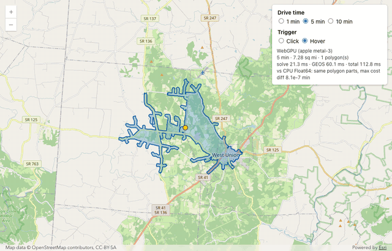
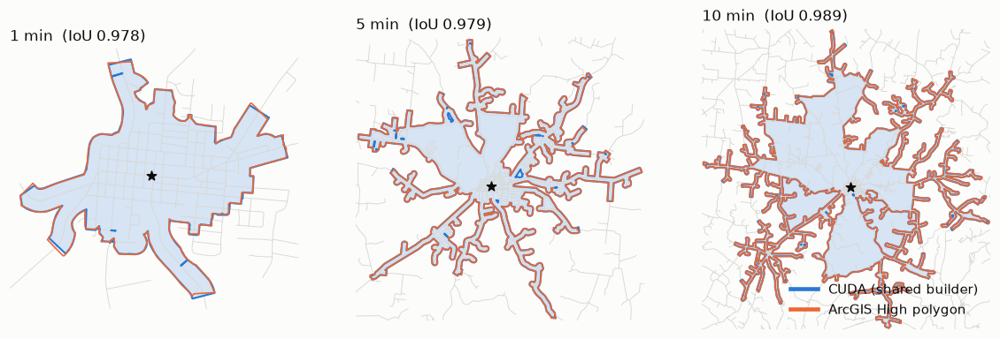
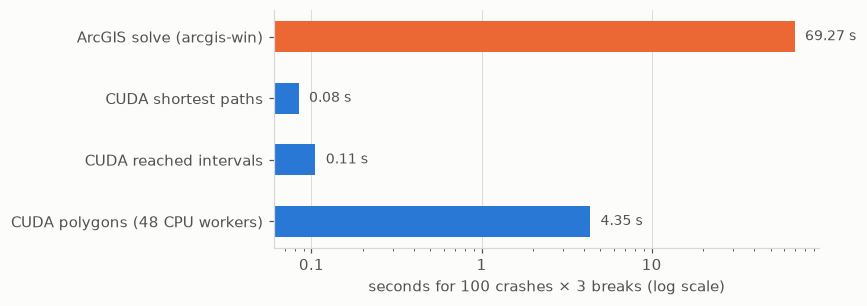
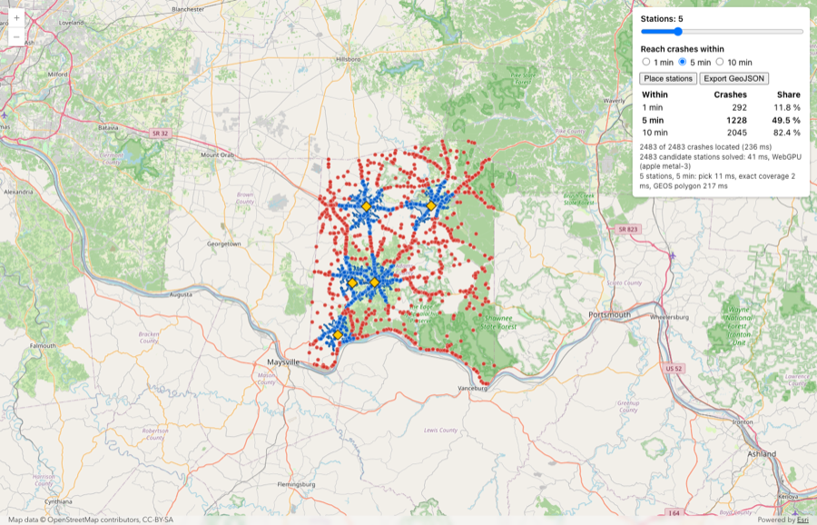

# Drive-Time Zones on a GPU, Checked Line by Line Against ArcGIS

> LinkedIn article draft. Cover image: `images/client_both.png`. Images do not paste into LinkedIn: upload each image where it appears below.

A car crashes on a county road in Adams County, Ohio. Which roads can you reach from that point in 5 minutes, and which area do they cover?

That area is a **service area**: the part of a road network that you can reach from one point in a given time. Planners use service areas to place fire stations, check ambulance coverage and decide where a new clinic helps the most people.

I have calculated service areas with Esri ArcGIS for years. ArcGIS gives the answer that planners trust, but it takes time. For 100 crash locations in Adams County, Ohio, at 1, 5 and 10 minutes, ArcGIS needs 69 seconds. For all 2,483 crashes in the county, it needs 31 minutes.

So I asked a question: can a graphics card (a GPU) give the same answer? For the reached roads, I wanted the same answer, not an approximate one.

*As the mouse moves along a road, the 5-minute drive-time zone updates at each position.*

## How a computer finds a service area

The computer sees a road network as lines and junctions. Each road has a travel time. The computer starts at the crash and moves out along the roads. It adds the travel time of each road. It stops when the total reaches the time limit.

The result has two parts:

- **The lines.** These are the roads that you can reach, cut at the exact point where the time runs out.
- **The area.** This is a shape drawn around the reached roads.

A GPU has thousands of small processors. I gave each crash its own group of processors, so the GPU calculates many crashes at the same time.

## "The same" must be measured

A fast answer has no value if it is wrong. So I compared every result with ArcGIS.

**The lines must agree exactly.** On 100 crashes, the GPU and ArcGIS agree on all 84,676 road pieces. The largest difference in travel time is about two millionths of a billionth of a minute (1.8e-15).

**The areas are close, but not exact.** ArcGIS smooths its shapes in a way that I cannot copy. So I built one method that draws the area, and I used it for both sides. On that test, 299 of 300 areas agree. Compared with the original ArcGIS shapes, the median overlap is 96 percent at 1 minute, 98 percent at 5 minutes and 99 percent at 10 minutes.

*One crash at 1, 5 and 10 minutes. Blue: my area. Orange: the ArcGIS area.*

One area did not agree. My first thought was a mistake in my code. I checked my code, then I checked the road data. Both were correct. The cause was in ArcGIS: for this one crash, ArcGIS did not cut one road at the time limit. For another crash, ArcGIS cut the same road correctly. I did not relax my test to hide this case. A looser test would also hide real mistakes.

## The speed

*Time for 100 crashes at 3 time limits. Each step on the scale is ten times larger than the one before.*

For the same 100 crashes:

- ArcGIS: **69.3 seconds**
- GPU, finding the reachable roads: **0.08 seconds**
- Drawing the areas: **4.35 seconds**

Finding the roads is now about 800 times faster than the ArcGIS solve. Drawing the shapes is now the slowest step, so that is the next thing to improve.

## In a web browser

The same method also runs in a normal web browser, with no server. A 10-minute calculation takes about three hundredths of a millisecond on my Mac. When an answer is that fast, you can ask a different question.

The planner page treats every crash location as a possible station. It calculates all 2,483 in about 40 milliseconds, then picks the best places. Five stations reach 1,228 crashes (49.5 percent) within 5 minutes.

*Five stations (yellow). Blue: crashes reached in 5 minutes. Red: crashes not reached.*

## What this does not show

- Adams County is small and rural. A large city is a harder test, and I have only a first test of 20 crashes in Franklin County (Columbus).
- The road speeds come from the road type. The data has no speed limits, no one-way streets and no traffic.
- The areas are close to ArcGIS, but they are not identical.

## Try it

The code and the Adams County test data are public on GitHub: https://github.com/mraad/service-area

The technical write-up is on my blog: https://thunderheadxpler.blogspot.com/2026/11/service-areas-on-gpu-and-in-browser.html

Next, I want to move the drawing step to the GPU and test a large city. More to come.

#GIS #ArcGIS #GPU #CUDA #WebGPU #EmergencyResponse #Geospatial
